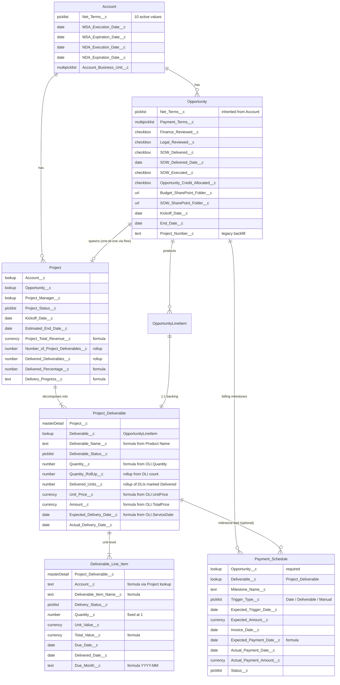

# Data Model

## Object map

## Cardinality and ownership

Project sits in a one-to-one relationship with Opportunity, enforced at create time by a before-save flow (`Prevent_Duplicate_Project_Per_Opportunity`) rather than by a Duplicate Rule — lookup fields don't carry the custom search index required by matching rules, so the rule-based approach is unavailable. The same idea on the side-car: Payment Schedule sits in a many-to-one relationship with Opportunity, marked `Restrict` on delete so a Closed Won Opp can never quietly lose its billing trail.

The Project → Project Deliverable and Project Deliverable → Deliverable Line Item relationships are both master-detail. This is a deliberate choice over lookup: it gives roll-up summary fields (`Quantity_RollUp__c`, `Delivered_Units__c`), inherits sharing from the parent (so the Project sharing model dictates downstream access), and cascades deletion in the rare case where a Project is removed in admin cleanup.

## Sharing model

`Project__c` and `Payment_Schedule__c` are both set to `Private` with `Public` visibility on the object itself — meaning users see the tab but only see the records the sharing model lets them see. The intent is to let a Project Manager see only their projects (driven by `Project_Manager__c` lookup-based sharing) and to let Finance see all Payment Schedules via the `Cash_Forecasting_Access` permission set, which doesn't carry `viewAllRecords` so it still respects record-level sharing.

Deliverables and DLIs inherit sharing from their parent Project via master-detail. There's no separate sharing surface to manage for the lower levels of the hierarchy — a deliberate simplification.

## Field naming conventions

API names are intentionally neutral and self-describing. Lookup fields use the standard `_c` suffix with no relationship label decoration; relationship names (`Projects`, `Project_Deliverables`, `Deliverable_Line_Items`, `Payment_Schedules`) are pluralized so they read naturally in SOQL. Formula fields carry a `description` that names the upstream source field explicitly, so a future maintainer running `sf project retrieve` and reading the XML can reconstruct the data flow without opening the Lightning Setup UI.
